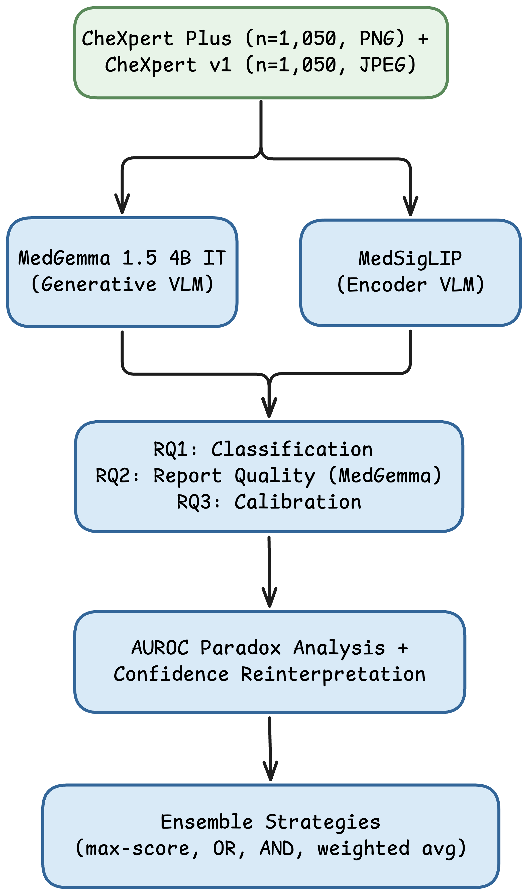

# Zero-Shot Pneumothorax Detection — MedGemma & MedSigLIP Evaluation

Evaluation code for the paper:

> **"Comparative Evaluation of Medical Vision-Language Models for Zero-Shot Pneumothorax Detection on Chest Radiographs"**

---

## Research Methodology



---

## Overview

This repository contains the complete evaluation pipeline for zero-shot pneumothorax (PTX) detection using two Google medical Vision-Language Models (VLMs):

- **MedGemma 1.5 4B IT** — generative medical VLM
- **MedSigLIP** — encoder-only medical VLM (SigLIP backbone)

Evaluated on two benchmark datasets:
- **CheXpert Plus** (n=1,050, PNG) — truly held-out for both models
- **CheXpert v1** (n=1,050, JPEG) — included in MedGemma's official evaluation data

Three research questions are addressed:
- **RQ1** — Binary classification performance (F1, Sensitivity, Specificity, AUROC, Precision)
- **RQ2** — Radiology report generation quality (BLEU-1, ROUGE-L, KW-Recall, Hallucination rate) — MedGemma only
- **RQ3** — Confidence calibration (ECE, Brier Score)

Post-hoc analyses include AUROC paradox investigation with confidence reinterpretation and ensemble strategies (max-score, OR, AND, weighted average).

---

## Repository Structure

```
final_code_2-2_1/
├── 1_benchmark/                    # Experiment 2 — main benchmark (n=1,050)
│   ├── notebooks2/
│   │   ├── chexpert_plus/
│   │   │   ├── 01-preparation.ipynb        # Dataset sampling & preparation
│   │   │   ├── 02-run-medgemma.ipynb       # MedGemma inference
│   │   │   ├── 03-run-medsiglip.ipynb      # MedSigLIP inference
│   │   │   └── 04-evaluation.ipynb         # RQ1 + RQ3 evaluation
│   │   └── chexpert_v1/                    # Same structure for CheXpert v1
│   ├── src2/                               # Shared source modules
│   │   ├── data.py                         # Dataset loading utilities
│   │   ├── medgemma_runner.py              # MedGemma inference wrapper
│   │   ├── medsiglip_runner.py             # MedSigLIP inference wrapper
│   │   ├── metrics.py                      # Evaluation metrics (ECE, Brier, F1, etc.)
│   │   ├── parser.py                       # Response parser for MedGemma output
│   │   ├── prompts.py                      # Prompt templates
│   │   └── utils.py                        # General utilities
│   └── outputs/                            # Inference results & evaluation outputs
│       ├── chexpert_plus/
│       └── chexpert_v1/
│
├── 2_ensamble/                     # Experiment 2.1 — AUROC paradox & ensemble
│   ├── notebooks2_1/
│   │   ├── chexpert_plus/
│   │   │   ├── 01-auroc-paradox.ipynb      # AUROC paradox investigation
│   │   │   └── 02-ensemble.ipynb           # Ensemble strategy evaluation
│   │   └── chexpert_v1/                    # Same structure for CheXpert v1
│   ├── src2_1/
│   │   └── ensemble.py                     # Ensemble strategies & confidence reinterpretation
│   └── outputs/                            # AUROC & ensemble results + figures
│       ├── chexpert_plus/
│       └── chexpert_v1/
│
├── fig_methodology_1.png           # Research methodology diagram
├── requirements.txt
└── README.md
```

---

## Key Findings

| Finding | CheXpert Plus | CheXpert v1 |
|---|---|---|
| MedGemma F1 | 0.3227 | 0.6491 |
| MedSigLIP F1 | 0.3475 | 0.4737 |
| MedGemma AUROC (raw) | 0.4797 ⚠ | 0.4389 ⚠ |
| MedGemma AUROC (reinterpreted) | 0.5814 | 0.7095 |
| MedSigLIP AUROC | 0.6047 | 0.4921 |
| MedSigLIP ECE | 0.1573 | 0.1694 |
| MedGemma ECE (raw) | 0.4153 | 0.4098 |
| Best ensemble sensitivity | 0.38 (max-score) | 0.72 (OR/max-score) |
| MedGemma hallucination rate | 63.3% | — |

> Neither model reaches the clinical sensitivity threshold of ≥0.80 in zero-shot setting.

---

## Setup

```bash
pip install -r requirements.txt
```

Model weights are loaded automatically via HuggingFace Hub on first run. A GPU with ≥16GB VRAM is recommended for MedGemma inference.

**Datasets** must be downloaded separately:
- [CheXpert Plus](https://stanfordaimi.azurewebsites.net/datasets/5158c524-d3ab-4e02-96e9-6ee9efc110a1)
- [CheXpert v1](https://stanfordmlgroup.github.io/competitions/chexpert/)

A curated sample subset used in this study is available on Kaggle: *(link will be added after upload)*.

Update the dataset paths in `01-preparation.ipynb` before running.

---

## Notebook Execution Order

**Experiment 2 (1_benchmark)** — run per dataset:
1. `01-preparation.ipynb` — sample and prepare subset CSV
2. `02-run-medgemma.ipynb` — run MedGemma inference → saves `medgemma.jsonl`
3. `03-run-medsiglip.ipynb` — run MedSigLIP inference → saves `medsiglip.jsonl`
4. `04-evaluation.ipynb` — compute RQ1 + RQ3 metrics → saves JSON results

**Experiment 2.1 (2_ensamble)** — requires Experiment 2 outputs:
1. `01-auroc-paradox.ipynb` — AUROC paradox analysis + confidence reinterpretation
2. `02-ensemble.ipynb` — ensemble strategy evaluation

---

## Citation

If you use this code, please cite:

```
[citation will be added after publication]
```

---

## License

This project is released for academic research purposes.
The datasets (CheXpert Plus, CheXpert v1) are subject to their respective licenses — please refer to the original dataset providers.
